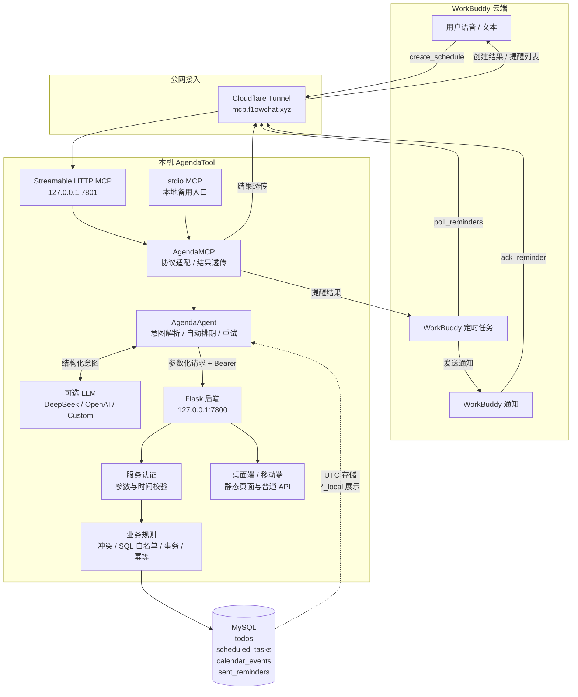
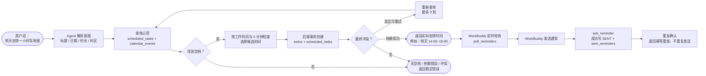
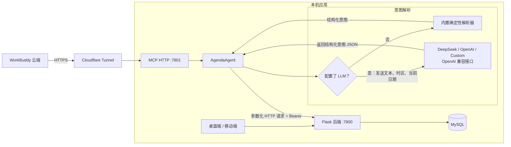
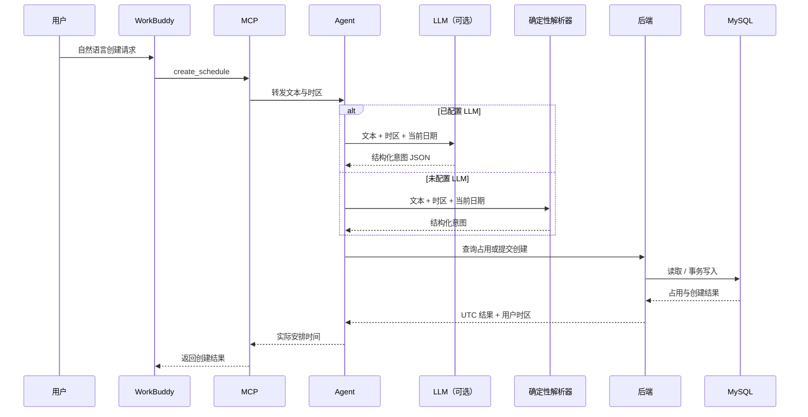
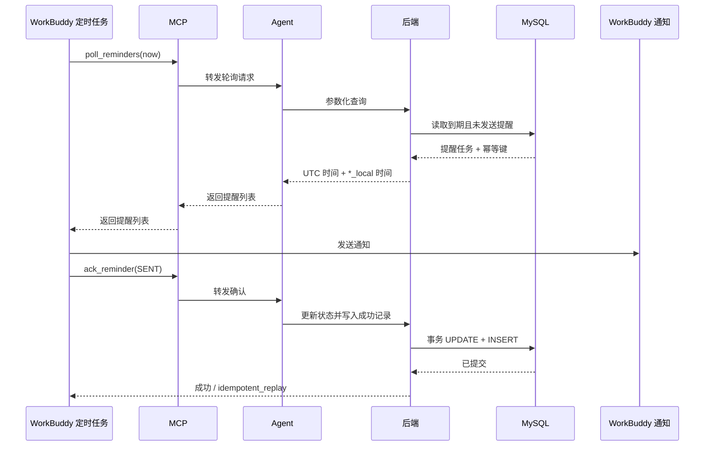

# 日程效率工具

## 可视化界面与 MySQL

本项目现在可以直接提供 `schedule-planner` 的桌面和移动端界面。桌面端访问
`http://127.0.0.1:7800/`，移动端访问 `http://127.0.0.1:7800/mobile`。
界面的“待办”页添加任务后会自动排期，结果同步显示在日历里；手动日程会占用自动排期可用的时间。
自动排期条目在日历中为只读，完成任务请到“待办”页操作。

首次构建界面：

```bash
cd /home/tony/AAActivity/WorkBuddy/AgendaTool/schedule-planner/schedule-planner
npm ci && npm run build
cd /home/tony/AAActivity/WorkBuddy/AgendaTool/schedule-planner/schedule-planner-mobile
npm ci && npm run build
```

启动已配置的数据库容器与服务（`mysql` 是当前环境的容器名；其他环境使用自己的名称）：

```bash
docker start mysql
cd /home/tony/AAActivity/WorkBuddy/AgendaTool/schedule-tool
python3 -m venv .venv
.venv/bin/pip install -r requirements.txt
.venv/bin/python app.py
```

`schedule-tool/.env` 使用独立的 MySQL 数据库 `agenda_tool` 和专用账号；不要将密码文件提交到版本库。
原来的 SQLite 模式仍可通过 `SCHEDULE_DB_BACKEND=sqlite` 使用，但不会自动迁移到 MySQL。

## 服务启动方式

本项目的运行链路由四部分组成：

```text
浏览器前端（由 Flask 提供静态文件）
  → 后端 Flask :7800
  → Agent / MCP HTTP :7801
  → Cloudflare Tunnel → WorkBuddy
```

### 推荐：启动 WorkBuddy 远程 MCP

使用 Cloudflare Tunnel 接入 WorkBuddy 时，只需要启动一个脚本。脚本会依次启动后端、
MCP HTTP 入口和 Tunnel；MySQL 需要先运行：

```bash
cd /home/tony/AAActivity/WorkBuddy/AgendaTool/schedule-tool
docker start mysql
./run_remote_mcp.sh
```

脚本读取当前目录的 `.env`，其中至少要配置：

```env
SCHEDULE_DB_BACKEND=mysql
SCHEDULE_INTERNAL_SERVICE_TOKEN=后端内部令牌
SCHEDULE_MCP_HTTP_TOKEN=WorkBuddy连接令牌
SCHEDULE_LLM_PROVIDER=deepseek
SCHEDULE_LLM_API_KEY=DeepSeek_API_Key
```

启动后：

- 前端和普通后端 API：`http://127.0.0.1:7800/`
- 移动端页面：`http://127.0.0.1:7800/mobile`
- 本地 MCP HTTP：`http://127.0.0.1:7801/mcp`
- WorkBuddy MCP：`https://mcp.f1owchat.xyz/mcp`

按 `Ctrl-C` 会停止脚本启动的后端、MCP 和 Tunnel。MySQL 容器需要单独停止时执行
`docker stop mysql`。

### 只启动本地前端和后端

不接 WorkBuddy 远程 MCP 时，先启动数据库，再启动 Flask：

```bash
cd /home/tony/AAActivity/WorkBuddy/AgendaTool/schedule-tool
docker start mysql
.venv/bin/python -c 'from app import app; app.run(host="127.0.0.1", port=7800, debug=False, use_reloader=False)'
```

该命令提供桌面端、移动端和普通 `/api/*` 接口，不启动 MCP HTTP 或 Cloudflare Tunnel。
需要使用 stdio MCP 时，另开终端运行 `./.venv/bin/python mcp.py`，并确保
`SCHEDULE_BACKEND_URL=http://127.0.0.1:7800`。

### 前端首次构建

如果 `schedule-planner/*/dist` 不存在，先构建前端；Flask 会直接提供构建产物：

```bash
cd /home/tony/AAActivity/WorkBuddy/AgendaTool/schedule-planner/schedule-planner
npm ci && npm run build
cd ../schedule-planner-mobile
npm ci && npm run build
```

一个本地运行的日程管理工具，支持：

- **添加待办** — 记录到配置的 SQLite 或 MySQL 数据库
- **档期编排** — 按优先级+截止时间自动把待办插入空闲时段
- **定时提醒** — 到点通过 Webhook 推送到你自建平台 / 企业微信 / 飞书

## 架构图（PPT 版本）

下面提供三种构图方式。A 适合技术评审，B 适合产品演示，C 适合拆成多页 PPT。

### A：技术架构总览



### B：产品演示闭环



### C：平衡版（部署图 + 两条数据流）

#### C1：部署与边界



#### C2：创建与自动排期数据流



#### C3：提醒轮询与确认数据流



### 调用边界

- WorkBuddy 只访问 MCP，不直接访问后端或 MySQL。
- MCP 只做协议适配、转发和结果透传。
- Agent 负责 LLM 意图解析、确定性排期、参数化请求和有限重试，不连接 MySQL。
- 后端负责认证、业务校验、冲突检查、SQL 白名单、事务和幂等。
- MySQL 统一存储 UTC；响应中的 `*_local` 字段用于用户时区展示。

现有 MCP 日程调用链：

```
用户在 WorkBuddy 聊天 → stdio MCP (mcp.py) → 本地 AgendaAgent → 后端 /api/internal/sql/execute → MySQL
消费方定时调用 poll_reminders → 消费方发送提醒 → ack_reminder 确认发送结果
```

上方 Flask 架构图描述的是原有待办、排期和 Webhook 功能。`app.py` 或
`cli.py server` 会启动旧版后台扫描；MCP 提醒使用查询与确认工具，需要消费方主动轮询。
使用 MCP 提醒时，建议采用下方「MCP 接入与验证」中的后端启动方式，避免同时运行两套提醒流程。

## 快速开始

```bash
cd /home/tony/AAActivity/WorkBuddy/AgendaTool/schedule-tool

# 方式 1: 交互式配置引导（推荐）
bash setup.sh

# 方式 2: 手动配置；已有 .env 时保留原配置
test -f .env || cp .env.example .env
# 编辑 .env 配置数据库；旧版推送另需配置 SCHEDULE_WEBHOOK_URL
python3 -m venv .venv
.venv/bin/python -m pip install -r requirements.txt

# 启动服务
.venv/bin/python cli.py server
```

`.env.example` 默认使用 SQLite；MCP SQL 后端需要将 `SCHEDULE_DB_BACKEND`
设为 `mysql`，并填写已有数据库的连接信息。不要用模板覆盖当前已配置的 `.env`。

## Webhook 推送配置

所有配置通过 `.env` 文件或环境变量管理。核心配置项：

| 变量 | 说明 | 默认值 |
|------|------|--------|
| `SCHEDULE_WEBHOOK_URL` | 推送目标 URL，留空则只打印控制台 | 空 |
| `SCHEDULE_WEBHOOK_FORMAT` | 消息格式：`generic` / `wecom` / `feishu` / `custom` | `generic` |
| `SCHEDULE_WEBHOOK_TIMEOUT` | 请求超时秒数 | `8` |
| `SCHEDULE_WEBHOOK_RETRY` | 失败重试次数（指数退避） | `3` |
| `SCHEDULE_WEBHOOK_HEADERS` | 自定义请求头 JSON | 空 |
| `SCHEDULE_WEBHOOK_TEMPLATE` | 自定义消息体模板（`format=custom` 时生效） | 见 .env |

### 四种消息格式

**generic（默认，适合自建平台）**

推送的 JSON body：
```json
{
  "event": "reminder",
  "text": "⏰ 日程提醒\n\n• [高] 写周报\n  开始: 2026-10-08 09:00",
  "count": 1,
  "items": [
    {"title": "写周报", "priority": 1, "start_at": "...", "end_at": "..."}
  ]
}
```

**wecom（企业微信群机器人）**

```json
{"msgtype": "text", "text": {"content": "⏰ 日程提醒\n\n• [高] 写周报..."}}
```

**feishu（飞书自定义机器人）**

```json
{"msg_type": "text", "content": {"text": "⏰ 日程提醒\n\n• [高] 写周报..."}}
```

**custom（自定义模板）**

用 `SCHEDULE_WEBHOOK_TEMPLATE` 配置模板，可用变量 `{text}` `{count}` `{items_json}`：

```bash
# .env 里
SCHEDULE_WEBHOOK_FORMAT=custom
SCHEDULE_WEBHOOK_TEMPLATE={"event":"reminder","message":"{text}","count":{count},"items":{items_json}}
```

### 自定义请求头

如果你的自建平台需要鉴权：

```bash
SCHEDULE_WEBHOOK_HEADERS={"Authorization":"Bearer your_token","X-Source":"schedule-tool"}
```

### 推送日志

每次推送（成功或失败）都记录到 `webhook_logs` 表，可通过 API 查询：

```bash
curl http://localhost:7800/api/webhook/logs?limit=20
```

返回字段：`event_type`、`url`、`payload`、`status_code`、`response_body`、`success`、`error`、`retry_count`、`duration_ms`、`created_at`。

## 使用

### 命令行

```bash
# 添加待办（自动编排）
python3 cli.py add "写周报" -p 2 -d "2026-10-08 18:00" -e 60
python3 cli.py add "回邮件"

# 列出待办
python3 cli.py list

# 手动触发编排
python3 cli.py schedule

# 看今天档期
python3 cli.py today

# 标记完成
python3 cli.py done 3

# 立即扫描一次提醒
python3 cli.py scan

# 启动 Flask 服务（含后台扫描线程）
python3 cli.py server
```

### HTTP API

```bash
# 添加待办
curl -X POST http://localhost:7800/api/todo \
  -H "Content-Type: application/json" \
  -d '{"title":"写周报","priority":2,"deadline":"2026-10-08T18:00","estimate_min":60}'

# 查所有待办
curl http://localhost:7800/api/todos

# 查档期
curl http://localhost:7800/api/schedule?days=3

# 手动触发编排
curl -X POST http://localhost:7800/api/schedule/run

# 标记完成
curl -X POST http://localhost:7800/api/todo/3/done

# 手动触发提醒扫描
curl -X POST http://localhost:7800/api/reminder/scan

# 查看 webhook 配置
curl http://localhost:7800/api/webhook/config

# 发送测试消息验证推送
curl -X POST http://localhost:7800/api/webhook/test \
  -H "Content-Type: application/json" \
  -d '{"message":"测试推送"}'

# 查看推送日志
curl http://localhost:7800/api/webhook/logs?limit=20
```

## 原有待办编排策略

未明确指定时间的待办，按以下顺序插入空闲时段：

1. **优先级**：1=高 > 2=中 > 3=低
2. **截止时间**：同优先级下，截止时间越早越先排
3. **时段匹配**：只在 `WORK_HOURS` 配置的时段里找空隙
4. **截止告警**：若截止前找不到空档，排到能找到的最早时段并给出告警

工作时段在 `config.py` 里改：

```python
WORK_HOURS = [
    (9, 0, 12, 0),
    (14, 0, 18, 0),
    (19, 30, 21, 30),
]
```

## MCP 接入与验证

当前提供 stdio MCP，支持协议版本 2024-11-05、2025-03-26、2025-06-18、2025-11-25。
工具包括 `create_schedule`、`poll_reminders` 和 `ack_reminder`。
本地 Agent 通过 HTTP 调用后端；MCP 只负责协议适配、请求转发和结果透传，默认地址为 `http://127.0.0.1:7800`，可用
`SCHEDULE_BACKEND_URL` 覆盖。后端 HTTP API 本身不是 HTTP MCP 接口。

准备 Python 环境：

```bash
cd /home/tony/AAActivity/WorkBuddy/AgendaTool/schedule-tool
python3 -m venv .venv
.venv/bin/python -m pip install -r requirements.txt
```

配置后端 `.env` 中的数据库连接，启动后端（以下方式不会启动旧版提醒扫描线程）：

此方式面向已经准备好表结构的 MySQL 数据库，不会调用 `app.main()` 的启动初始化。
在全新环境中，应先完成数据库和表结构准备，再进行 MCP 联调。

```bash
.venv/bin/python -c 'from app import app; app.run(host="127.0.0.1", port=7800, debug=False, use_reloader=False)'
```

如果 WorkBuddy 的 MCP 设置支持本地命令 / stdio，可填写下面的启动信息。
以下 JSON 是常见 MCP 客户端配置示例；WorkBuddy 的字段和导入格式需以实际设置页面为准。

```json
{
  "mcpServers": {
    "agenda": {
      "command": "/home/tony/AAActivity/WorkBuddy/AgendaTool/schedule-tool/.venv/bin/python",
      "args": ["/home/tony/AAActivity/WorkBuddy/AgendaTool/schedule-tool/mcp.py"],
      "env": {"SCHEDULE_BACKEND_URL": "http://127.0.0.1:7800"}
    }
  }
}
```

由客户端启动 MCP 进程，并检查工具列表是否出现三个工具。可以输入
「明天下午三点安排一小时项目讨论」来尝试创建日程；调用参数需要包含一个
1–64 字符的 `request_id` 和 `text`，`timezone` 可指定 `Asia/Shanghai`。

提醒工具只提供查询和确认：消费方需要定时调用 `poll_reminders`，完成发送后，
再用返回的任务 ID 和幂等键调用 `ack_reminder`。接入 MCP 本身不会自动开启提醒轮询。

WorkBuddy 云端不能启动本机 stdio MCP。本项目提供 Streamable HTTP 远程入口，
并通过 Cloudflare Tunnel 在 `https://mcp.f1owchat.xyz/mcp` 暴露服务。启动方式见下方。

错误响应统一为顶层 `retryable` 与 `error.code`/`error.message`；单次逻辑请求最多 3 轮完整尝试，每轮可包含查询和创建。服务认证仍由后端执行，不能通过 SQL 批次绕过业务校验。LLM 供应商由部署配置决定。

Agent 可通过 `.env` 的 `SCHEDULE_LLM_PROVIDER` 切换 OpenAI 兼容的 Chat Completions 服务。`deepseek` 默认使用 `https://api.deepseek.com/v1` 和 `deepseek-chat`；`openai` 默认使用 `https://api.openai.com/v1` 和 `gpt-4o-mini`；`custom` 需要额外填写 `SCHEDULE_LLM_BASE_URL` 和 `SCHEDULE_LLM_MODEL`。填写 `SCHEDULE_LLM_API_KEY` 后重启 Agent/MCP 即生效；显式填写 BASE_URL 或 MODEL 可覆盖 provider 默认值。三项 LLM 配置全部留空时使用内置确定性解析器，provider 已设置但 key 缺失会返回配置错误。LLM 只返回经过 schema 校验的结构化意图；SQL 参数和排期仍由 Agent 确定性生成。API 密钥只用于 Agent 到 LLM 的请求，不传给 MCP 工具参数或业务后端。

创建结果和提醒查询中的 `start_at`、`end_at`、`reminder_at` 为 UTC 数据库时间；
`timezone` 表示用户日历时区。对应的 `*_local` 字段（例如 `start_at_local`）
提供带 UTC 偏移的本地时间，WorkBuddy 展示时应优先使用这些本地字段，避免再次转换 UTC。

本地协议测试不连接数据库：

```bash
python3 -m unittest discover -s tests -p 'test_mcp.py' -v
```

这些测试验证本地 stdio 协议行为。真实 WorkBuddy 远程联调已通过下方 Cloudflare Tunnel 入口完成。


### WorkBuddy 云端远程连接（Streamable HTTP）

在后端所在主机设置独立的 MCP 访问令牌（与 `SCHEDULE_INTERNAL_SERVICE_TOKEN` 不同），并启动入口：

```bash
export SCHEDULE_MCP_HTTP_TOKEN='<独立的随机令牌>'
python3 mcp_http.py
```

默认监听 `127.0.0.1:7801`。将 HTTPS 反向代理或隧道的 `/mcp` 转发到
`http://127.0.0.1:7801/mcp`，并保留 Authorization、Accept 和 MCP-Protocol-Version 请求头。
如在容器中运行，可设置 `SCHEDULE_MCP_HTTP_HOST=0.0.0.0`；端口用
`SCHEDULE_MCP_HTTP_PORT` 配置。Agent 的后端地址仍由 `SCHEDULE_BACKEND_URL` 指定，
后端内部认证使用其原有令牌。入口不启动数据库或旧版提醒扫描线程。

在 WorkBuddy 的 MCP 设置中添加（替换域名和令牌）：

```json
{
  "mcpServers": {
    "agenda": {
      "type": "http",
      "url": "https://<你的可达域名>/mcp",
      "headers": {"Authorization": "Bearer <独立的随机令牌>"}
    }
  }
}
```

点击 Try to Run 后检查三个工具。这里只提供 Streamable HTTP，未提供旧式 SSE 入口。
该传输采用无会话 JSON 响应，不发送服务器主动事件；客户端仍可调用提醒查询与确认。
带 Origin 的请求须匹配 `SCHEDULE_MCP_ALLOWED_ORIGINS`（逗号分隔的完整来源）；
默认不接受任何带 Origin 的请求，无 Origin 的服务端客户端可访问。不要在公开配置中提交令牌。

本地验证：

```bash
python3 -m unittest discover -s tests -p test_mcp_http.py -v
```

本地 HTTP 验证包含初始化、三个工具、鉴权、Origin、协议校验，以及真实网络请求
经 MCP → Agent 到达后端。真实公网验收另通过 Cloudflare Tunnel 和 WorkBuddy 完成，
包含日程创建、冲突处理、提醒轮询、提醒确认及重复确认幂等；真实记录见 SDD 任务清单 T11。

### 使用现有 Cloudflare Tunnel 暴露远程 MCP

本机已配置 `mcp.f1owchat.xyz` → `127.0.0.1:7801`。启动：

```bash
cd /home/tony/AAActivity/WorkBuddy/AgendaTool/schedule-tool
./run_remote_mcp.sh
```

该命令前台运行 MCP 和 Cloudflare Tunnel，按 `Ctrl-C` 会同时关闭两者。不要关闭终端，
否则 WorkBuddy 将无法访问。`.env` 中的 `SCHEDULE_MCP_HTTP_TOKEN` 是独立的 MCP 令牌，
不要提交或粘贴到聊天中。

WorkBuddy 配置：

```json
{
  "mcpServers": {
    "agenda": {
      "type": "http",
      "url": "https://mcp.f1owchat.xyz/mcp",
      "headers": {
        "Authorization": "Bearer <SCHEDULE_MCP_HTTP_TOKEN 的值>"
      }
    }
  }
}
```

在 WorkBuddy 的 MCP 设置中点击 **Try to Run**，确认列出 `create_schedule`、
`poll_reminders`、`ack_reminder` 三个工具。真实联调已验证这三个工具可经公网访问，
创建、提醒轮询、发送确认及重复确认幂等均正常。每次使用时保持 `run_remote_mcp.sh`
运行；结束服务时按 Ctrl-C。
