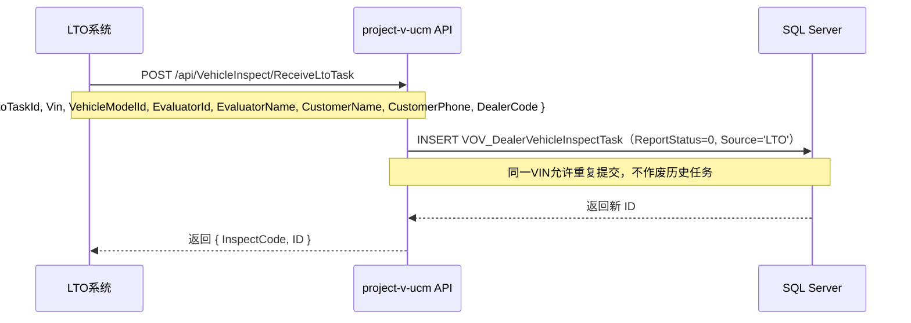
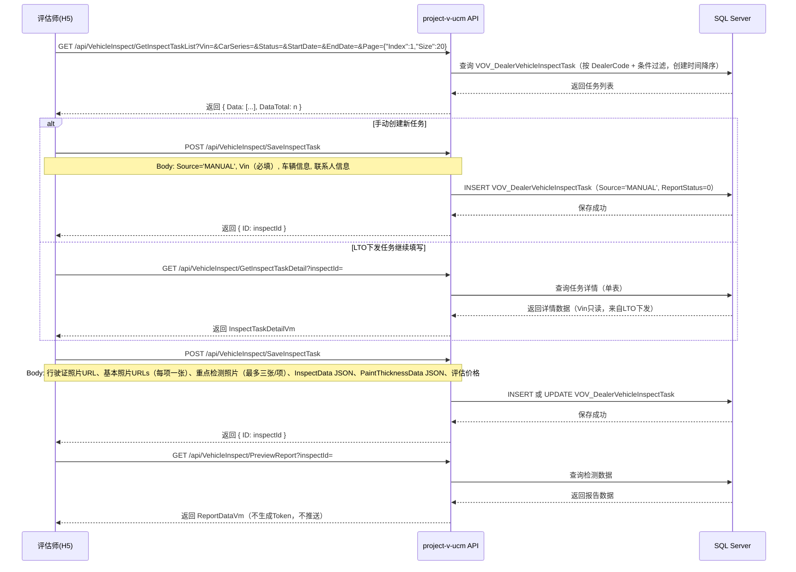
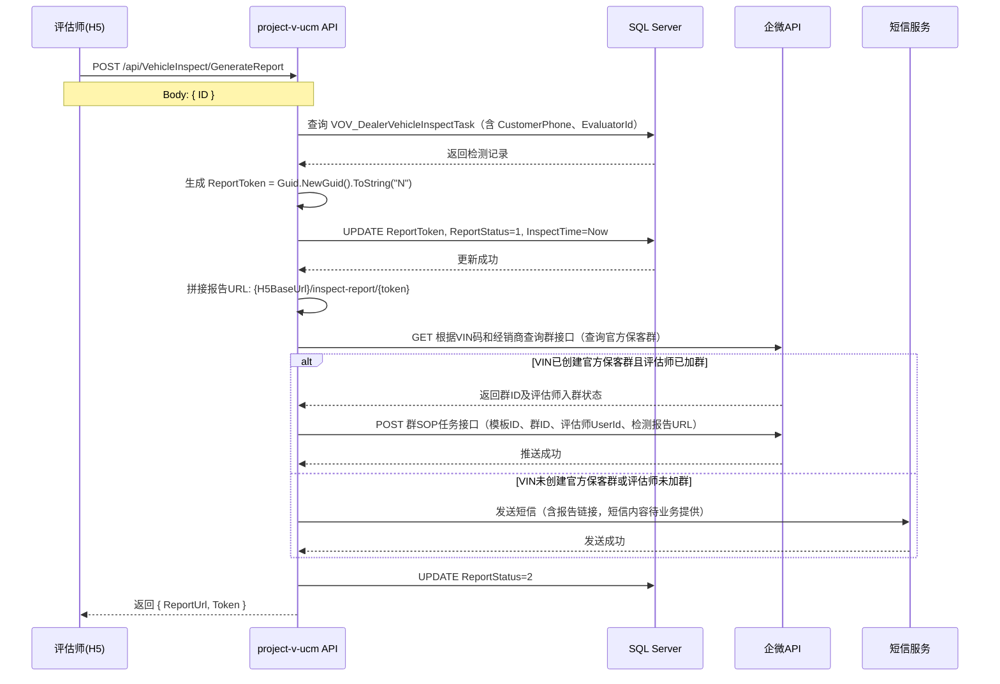
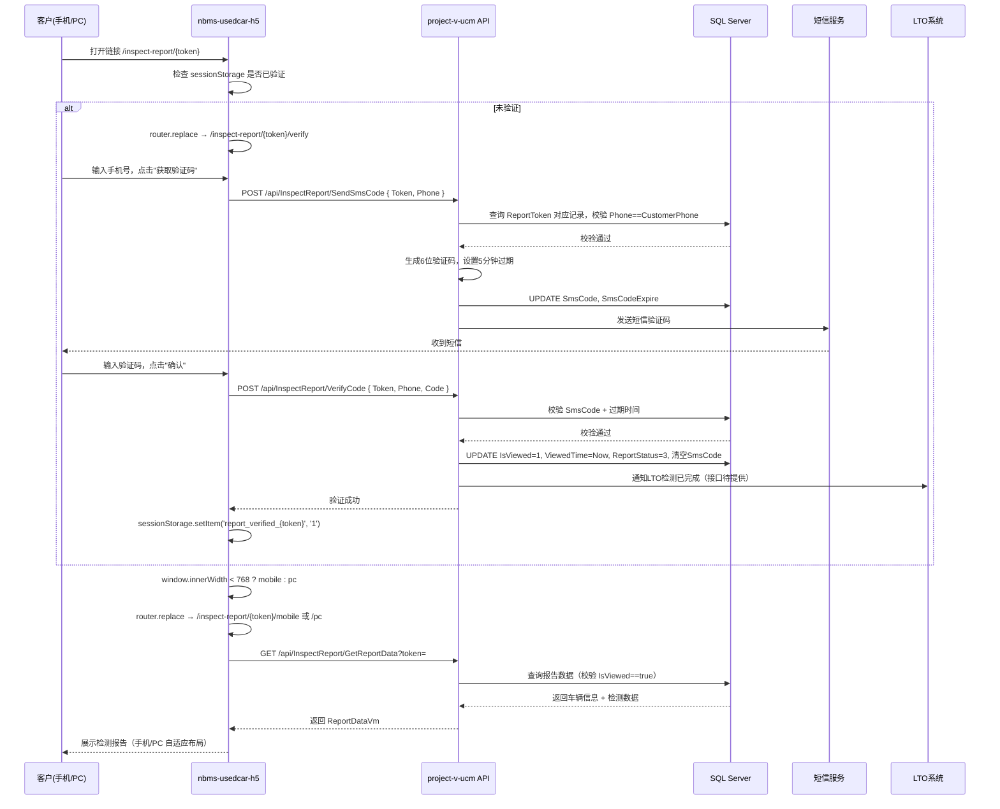
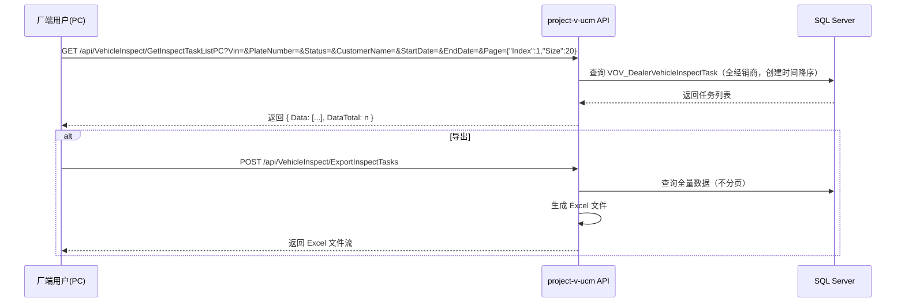
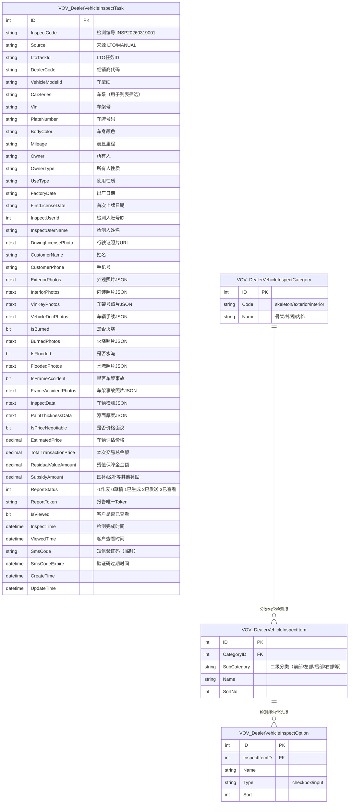

# 技术方案：经销商收车检测模块

## 一、需求概要

### 1.1 需求背景

目前保客营销检测率低、客户留店时间短，导致检测障碍，以及随着企微线索量增长也带来了流程上的适配问题。V2.0 版本在原有基础上打通 LTO 系统，由 LTO 下发检测任务到 NBMS，并在客户查看报告后回写 LTO 检测完成状态，同时新增 PC 端检测任务管理列表供厂端查询。

### 1.2 业务价值/业务目标

通过系统化的检测任务管理和报告生成流程，提升二手车评估师的工作效率，规范检测报告的输出标准，并通过企微任务推送和客户手机验证机制，确保检测报告能够安全、准确地传递给目标客户，同时实现客户已读状态的自动回写及 LTO 检测完成通知。

### 1.3 需求目标

在 nbms-usedcar-h5（Vue3 H5 前端）、project-v-ucm（ASP.NET Web API 后端）和 PC 管理端上实现经销商收车检测模块，包含：LTO 下发检测任务、检测任务列表与详情（企微+PC）、检测任务新增/修改（多步骤表单）、检测报告预览、检测报告生成与企微/短信推送、客户端手机验证查看报告（PC/手机双端同链接自适应）、客户已读状态回写及 LTO 完成通知。

### 2、PRD

[03-经销商收车检测模块 PRD|https://confluence.project-v.internal/spaces/CEDTMOS/pages/347775363/03-经销商收车检测模块]

### 3、UIX

检测报告设计稿已由张伟（BA）提供，已导出为 HTML 参考文件：`D:\Projects\ProjectV\企微检测\检测报告\检测报告.html`

### 4、UserCases

| 业务需求主题 | 用户类型 | 功能概述 |
|---|---|---|
| 检测任务创建（LTO下发） | 系统（LTO） | LTO 下发检测任务到 NBMS，同一 VIN 允许重复提交 |
| 检测任务创建（手动） | 二手车评估师 | 评估师在企微检测管理列表点击【新建】手动创建检测任务 |
| 检测任务列表（企微） | 二手车评估师、二手车经理 | 按 VIN/车系/创建时间/检测状态查询检测任务列表 |
| 车辆检测 | 二手车评估师 | 录入车辆信息（行驶证OCR）、联系人信息、基本照片、重点检测、车辆检测项、漆面厚度、评估价格 |
| 检测报告预览 | 二手车评估师 | 预览检测报告样式，不触发推送 |
| 检测报告生成 | 二手车评估师 | 生成正式报告，优先企微任务推送，降级短信发送 |
| 查看检测报告 | 客户 | 客户通过链接输入手机号+验证码查看报告（PC/手机自适应） |
| 检测报告已读回写 | 系统 | 客户验证通过后自动回写已读状态，并通知 LTO 检测完成 |
| 检测任务列表（PC） | 厂端 | 查询所有经销商检测任务，支持导出和查看报告 |

---

## 二、技术方案

### 1、时序图

#### 1.1 LTO 下发检测任务



#### 1.2 检测任务管理（列表 + 新增/修改 + 预览）



#### 1.3 检测报告生成与发送



#### 1.4 客户验证查看报告与已读回写



#### 1.5 检测任务列表（PC）



---

### 2、接口说明

#### 接口列表

| 序号 | 用户故事 | 功能点 | 变化 | 接口地址 | 类型 | 入参 | 出参 |
|---|---|---|---|---|---|---|---|
| 1 | 检测任务创建（LTO） | LTO下发检测任务 | 新增 | /api/VehicleInspect/ReceiveLtoTask | POST | ReceiveLtoTaskIm | { InspectCode, ID } |
| 2 | 检测任务列表（企微） | 按条件查询检测任务列表 | 变更 | /api/VehicleInspect/GetInspectTaskList | GET | Vin, CarSeries, Status, StartDate, EndDate, Page(JSON) | 分页列表 |
| 3 | 检测任务详情 | 查询单条检测任务详情 | 不变 | /api/VehicleInspect/GetInspectTaskDetail | GET | inspectId | InspectTaskDetailVm |
| 4 | 检测任务保存 | 新增或修改检测任务 | 变更 | /api/VehicleInspect/SaveInspectTask | POST | SaveInspectTaskIm | { ID } |
| 5 | 行驶证OCR识别 | 上传行驶证图片，OCR识别车辆信息 | 新增 | /api/VehicleInspect/RecognizeDrivingLicense | POST | { ImageUrl } | OcrResultVm |
| 6 | 检测报告预览 | 预览报告（评估师，无需Token） | 变更 | /api/VehicleInspect/PreviewReport | GET | inspectId | ReportDataVm |
| 7 | 检测报告生成 | 生成报告+企微/短信推送 | 变更 | /api/VehicleInspect/GenerateReport | POST | { ID } | { ReportUrl, Token } |
| 8 | 发送短信验证码 | 客户端发送验证码 | 不变 | /api/InspectReport/SendSmsCode | POST | { Token, Phone } | success |
| 9 | 验证短信码+回写 | 验证码校验+已读回写+通知LTO | 变更 | /api/InspectReport/VerifyCode | POST | { Token, Phone, Code } | success |
| 10 | 获取报告数据 | 客户端/PC端获取报告 | 不变 | /api/InspectReport/GetReportData | GET | token | ReportDataVm |
| 11 | 检测任务列表（PC） | 厂端查询所有检测任务 | 新增 | /api/VehicleInspect/GetInspectTaskListPC | GET | Vin, PlateNumber, Status, CustomerName, StartDate, EndDate, Page(JSON) | 分页列表 |
| 12 | 导出检测任务 | 厂端导出检测任务列表 | 新增 | /api/VehicleInspect/ExportInspectTasks | POST | 同查询条件 | Excel文件流 |

#### 接口方案实现

**① LTO 下发检测任务（ReceiveLtoTask）**

接收 LTO 系统推送的检测任务。直接新建任务记录，不查询也不作废历史任务（同一 VIN 允许重复提交）。`InspectCode = INSP{yyyyMMdd}{当日序号:D3}`，`ReportStatus = 0`，`Source = 'LTO'`，Vin 字段在后续填写阶段只读不可修改。接口需校验 LTO 调用方身份（Token 或 IP 白名单，具体认证方式待与 LTO 确认）。

**② 检测任务列表（GetInspectTaskList）**

在原有 VIN 过滤基础上，新增 `CarSeries`（车系）、`Status`（检测状态）、`StartDate`/`EndDate`（创建时间范围）查询条件。权限校验：当前登录用户须为二手车评估师或二手车经理，按 `DealerCode` 过滤数据，不返回 `ReportStatus = -1`（已作废）的任务。

**③ 检测任务保存（SaveInspectTask）**

在原有字段基础上，新增以下字段的保存：`DrivingLicensePhoto`（行驶证照片，替换原身份证照片）、`IsFrameAccident`/`FrameAccidentPhotos`（车架事故，替换原改装/调表/铭牌字段）、`PaintThicknessData`（漆面厚度 JSON）、`EstimatedPrice`/`TotalTransactionPrice`/`ResidualValueAmount`/`SubsidyAmount`/`IsPriceNegotiable`（评估价格相关字段）。

**Source 来源区别处理**：
- `Source = 'MANUAL'`（手动创建）：`ID` 为空时新建任务，Vin 为用户输入的必填字段；
- `Source = 'LTO'`（LTO下发）：任务已存在，不允许修改 Vin，保存时忽略入参中的 Vin 字段。

**照片张数约束**：外观/内饰/车架号每项限一张；火烧/水淹/车架事故照片最多三张，后端校验数组长度不超过 3。

已生成报告（`ReportStatus >= 1`）的任务不允许修改。

**④ 行驶证 OCR 识别（RecognizeDrivingLicense）**

接收前端上传的行驶证图片 URL，调用 OCR 服务识别并返回结构化字段。返回结果 `OcrResultVm` 包含：`Owner`（所有人）、`PlateNumber`（车牌号码）、`UseType`（使用性质）、`VehicleModelId`（品牌车型，OCR 识别后需与系统车型库做模糊匹配）、`FactoryDate`（出厂日期）、`FirstLicenseDate`（首次上牌日期）。所有字段均为可选，前端收到后回填表单，用户可手动修改。OCR 识别失败时返回空对象，不抛出异常，由前端提示用户手动填写。

**⑤ 检测报告预览（PreviewReport）**

预览接口为纯读取，不保存数据、不生成 Token、不触发推送。**前端在调用预览前，须先调用 `SaveInspectTask` 保存当前填写的评估价格**，再调用本接口获取报告数据渲染预览页。预览页不展示发送按钮。

**⑥ 检测报告生成（GenerateReport）**

生成 32 位无连字符 GUID 作为 `ReportToken`，更新 `ReportToken`、`ReportStatus = 1`、`InspectTime = Now`。随后判断发送方式：

- **企微发送**：调用【根据 VIN 码和经销商查询群接口（参见企微 API 文档接口1）】，若 VIN 已创建官方保客群且评估师已加群，则调用【群 SOP 任务个性化消息接口】推送报告链接。接口规范如下：

  ```
  POST /base/api/wechatSopTask/sendSopTaskMessage
  服务：dse-wechat-base-ability（企微基础能力服务）

  Header:
    Appkey:    {Appkey}
    Signature: {Signature}
    Timestamp: {Timestamp}
    Nonce:     {Nonce}

  Body (application/json):
  {
    "taskId":                 117,              // 主任务ID（检测报告推送模板ID，待业务方提供）
    "ownerUserId":            "123456",         // 执行任务顾问的认证中心 UserId（即 InspectUserId）
    "targetId":               "wrYcvgVA...",    // 目标群ID（由查群接口返回的 GroupId）
    "type":                   0,                // 目标类型：0=群（默认），1=外部联系人
    "customizeParamValueMap": {                 // 个性化占位符，key 为模板中的占位符名称
      "reportUrl": "{ReportUrl}"               // 检测报告链接（占位符名称待业务方与企微侧确认）
    },
    "repeatSendStatus":       0                 // 0=不重复发送（默认）
  }

  Response:
  {
    "code": 0,      // 0=成功；9001=任务不存在或已禁用；9002=任务已执行；9003=顾问不在群中；9999=未知异常
    "msg":  "..."
  }
  ```

  > **待确认**：`taskId`（检测报告推送模板ID）和 `customizeParamValueMap` 中的占位符名称需业务方与企微侧确认后填入。

- **短信降级**：VIN 未创建官方保客群、评估师未加群、或企微接口返回非 0 时，发送短信（短信内容待业务提供）。

发送成功后更新 `ReportStatus = 2`。调用企微查群或 SOP 接口失败时，降级为短信发送，不抛出异常，记录错误日志。

**⑦ 验证码校验+回写（VerifyCode）**

校验通过后，除原有回写 `IsViewed = 1`、`ViewedTime`、`ReportStatus = 3`、清空 `SmsCode` 外，新增调用 LTO 接口通知检测已完成（接口待提供，调用失败不影响主流程，记录错误日志）。

**⑧ 检测任务列表 PC（GetInspectTaskListPC）**

厂端接口，不按 `DealerCode` 过滤，查询全量数据。列表返回字段：编号、VIN、车牌号、品牌车型、客户名称、经销商代码、检测状态、评估师、创建时间、检测时间、查看时间。操作列仅在 `ReportStatus = 3`（已查看）时返回 `ReportToken` 供前端拼接报告链接。

---

#### ER 关系图



#### 2.4 框架技术方案

**前端框架**

前端脚手架框架 Vue 3.5 + TypeScript，前端 UI 框架 Vant 4（移动端），CSS 框架 Tailwind CSS，HTTP 客户端 Alova 3，构建工具 Vite 6。

前端新增路由模块 `src/router/routes/modules/inspection.ts`，包含评估师端（需登录）的检测任务列表、检测任务详情页，以及客户端（无需登录，绝对路径 `/inspect-report/:token`）的验证页、手机端报告页、PC 端报告页。客户端路由在登录守卫白名单中排除。

设备类型判断逻辑：`window.innerWidth < 768` 为手机端，跳转 mobile 子路由；否则跳转 pc 子路由。验证状态存储于 `sessionStorage`，关闭标签页后需重新验证。

**ReportStatus 与前端显示状态映射**

| ReportStatus | 含义 | 前端列表显示状态 |
|---|---|---|
| 0 | 草稿（进行中） | 进行中 |
| 1 | 已生成报告 | 待查看 |
| 2 | 已发送给客户 | 待查看 |
| 3 | 客户已查看 | 已查看 |
| -1 | 已作废 | 不在列表中展示 |

ReportStatus = 1 和 2 在前端均显示为"待查看"，区别仅在后端记录发送状态。作废状态（-1）由后端内部逻辑触发（如 LTO 撤销任务），暂无前端入口，具体触发条件待与 LTO 确认（见待确认事项6）。

**前端按钮状态控制**

评估价格页面底部按钮根据 `ReportStatus` 控制显示：

| ReportStatus | 显示按钮 |
|---|---|
| 0（进行中） | 检测报告预览 + 生成检测报告 |
| 1 / 2（待查看） | 仅检测报告预览 |
| 3（已查看） | 仅检测报告预览 |

已生成报告（`ReportStatus >= 1`）时，表单所有字段切换为只读模式，不展示保存/下一步按钮。

**漆面厚度标准值**

标准值区间在前端硬编码（与 PRD 保持一致）。后端 `PaintThicknessData` 只存储实测值 `[{"name":"前盖","value":135},...]`。`ReportDataVm` 中同步返回标准值区间列表，供报告页渲染红色超标提示：

```json
"paintThicknessStandards": [
  { "name": "前盖", "min": 120, "max": 160 },
  { "name": "左前翼子板", "min": 110, "max": 150 }
]
```

**PC 端查看报告权限**

厂端通过 `GetInspectTaskListPC` 获取 `ReportToken` 后，拼接报告链接 `/inspect-report/{token}`。PC 端打开该链接时，由于 `window.innerWidth >= 768` 会直接跳转 pc 子路由，但仍需经过手机验证流程（输入客户手机号+验证码）。若业务方要求厂端免验证直接查看，需新增后台专用查看接口（待确认，见待确认事项7）。

**后端框架**

使用原有 project-v-ucm（ASP.NET Web API）后端框架，在现有 `VehicleInspectController` 和 `InspectReportController` 中扩展新接口。企微集成复用现有 `AccountBLL.cs` 中的 `GetNewbieToken` 和 HMACSHA256 签名认证模式。EF 实体类由开发人员手动维护（不走 T4 自动生成），新增 `VOV_DealerVehicleInspectTask` 实体类并在 `ProjectVUCMEntities` 中注册 `DbSet`。

---

### 3、建表以及现有表变更语句

```sql
-- ============================================================
-- 新建 VOV_DealerVehicleInspectTask 表（V2.0 版本）
-- 全新独立表，单表存储所有检测数据
-- ============================================================
CREATE TABLE [dbo].[VOV_DealerVehicleInspectTask] (
    [ID]                     INT            IDENTITY(1,1)  NOT NULL,
    [InspectCode]            NVARCHAR(50)   NOT NULL,
    [Source]                 NVARCHAR(20)   NOT NULL DEFAULT 'MANUAL',  -- LTO / MANUAL
    [LtoTaskId]              NVARCHAR(100)  NULL,
    [DealerCode]             NVARCHAR(50)   NOT NULL,
    -- 车辆基本信息
    [VehicleModelId]         NVARCHAR(50)   NULL,
    [CarSeries]              NVARCHAR(50)   NULL,
    [Vin]                    NVARCHAR(20)   NULL,
    [PlateNumber]            NVARCHAR(20)   NULL,
    [BodyColor]              NVARCHAR(20)   NULL,
    [Mileage]                NVARCHAR(20)   NULL,
    [Owner]                  NVARCHAR(50)   NULL,
    [OwnerType]              NVARCHAR(20)   NULL,
    [UseType]                NVARCHAR(20)   NULL,
    [FactoryDate]            NVARCHAR(20)   NULL,
    [FirstLicenseDate]       NVARCHAR(20)   NULL,
    -- 检测人
    [InspectUserId]          INT            NOT NULL DEFAULT 0,
    [InspectUserName]        NVARCHAR(50)   NULL,
    -- 行驶证 & 联系人
    [DrivingLicensePhoto]    NTEXT          NULL,
    [CustomerName]           NVARCHAR(50)   NULL,
    [CustomerPhone]          NVARCHAR(20)   NULL,
    -- 基本照片（JSON对象，每项单张）
    [ExteriorPhotos]         NTEXT          NULL,
    [InteriorPhotos]         NTEXT          NULL,
    [VinKeyPhotos]           NTEXT          NULL,
    [VehicleDocPhotos]       NTEXT          NULL,
    -- 重点检测（照片为JSON数组，最多三张：["url1","url2","url3"]）
    [IsBurned]               BIT            NOT NULL DEFAULT 0,
    [BurnedPhotos]           NTEXT          NULL,
    [IsFlooded]              BIT            NOT NULL DEFAULT 0,
    [FloodedPhotos]          NTEXT          NULL,
    [IsFrameAccident]        BIT            NOT NULL DEFAULT 0,
    [FrameAccidentPhotos]    NTEXT          NULL,
    -- 车辆检测数据
    [InspectData]            NTEXT          NULL,
    -- 漆面厚度数据（JSON: [{"name":"前盖","value":135},...]）
    [PaintThicknessData]     NTEXT          NULL,
    -- 评估价格
    [IsPriceNegotiable]      BIT            NOT NULL DEFAULT 0,
    [EstimatedPrice]         DECIMAL(18,2)  NULL,
    [TotalTransactionPrice]  DECIMAL(18,2)  NULL,
    [ResidualValueAmount]    DECIMAL(18,2)  NULL,
    [SubsidyAmount]          DECIMAL(18,2)  NULL,
    -- 报告相关
    [ReportStatus]           INT            NOT NULL DEFAULT 0,  -- -1作废 0草稿 1已生成 2已发送 3已查看
    [ReportToken]            NVARCHAR(100)  NULL,
    [IsViewed]               BIT            NOT NULL DEFAULT 0,
    [InspectTime]            DATETIME       NULL,
    [ViewedTime]             DATETIME       NULL,
    [SmsCode]                NVARCHAR(10)   NULL,
    [SmsCodeExpire]          DATETIME       NULL,
    -- 时间戳
    [CreateTime]             DATETIME       NOT NULL DEFAULT GETDATE(),
    [UpdateTime]             DATETIME       NULL,

    CONSTRAINT [PK_VOV_DealerVehicleInspectTask] PRIMARY KEY CLUSTERED ([ID] ASC)
);

-- ReportToken 唯一索引
CREATE UNIQUE INDEX [IX_InspectTask_ReportToken]
    ON [dbo].[VOV_DealerVehicleInspectTask] ([ReportToken])
    WHERE [ReportToken] IS NOT NULL;

-- 企微端列表查询索引
CREATE INDEX [IX_InspectTask_DealerCode_CreateTime]
    ON [dbo].[VOV_DealerVehicleInspectTask] ([DealerCode], [CreateTime] DESC);

-- PC端列表查询索引
CREATE INDEX [IX_InspectTask_Status_CreateTime]
    ON [dbo].[VOV_DealerVehicleInspectTask] ([ReportStatus], [CreateTime] DESC);
```

### 4、定时任务设计

本次功能不涉及定时任务，均为实时处理。

---

## 三、其他相关

### 1、影响业务范围

- 企业微信二手车收车检测流程（评估师端 H5 + 客户端报告查看）
- LTO 系统（任务下发 + 检测完成回调）
- PC 管理端（厂端检测任务查询与导出）

### 2、影响历史数据

全新独立表，不修改任何现有表结构，不影响历史数据。

### 3、涉及微服务名称

无独立微服务，均在现有 project-v-ucm（ProjectVUCM.Dealer.WebApi）和 nbms-usedcar-h5 项目中实现。

### 4、待确认事项

| 序号 | 事项 | 状态 | 负责人 |
|---|---|---|---|
| 1 | LTO 下发检测任务接口规范（入参格式、认证方式） | 待确认 | LTO 侧 |
| 2 | 根据VIN码和经销商查询官方保客群接口 | 已有文档（见企微 API 文档接口1） | 张伟（BA） |
| 3 | 群 SOP 任务接口（含模板ID参数） | ✅ 已确认（`POST /base/api/wechatSopTask/sendSopTaskMessage`，见⑥企微发送段落）；taskId 和占位符名称待业务方与企微侧确认 | 张伟（BA） |
| 4 | 客户查看后通知 LTO 完成的回调接口 | 待确认 | LTO 侧 |
| 5 | 短信发送内容模板 | 待确认 | 业务方 |
| 6 | 作废状态（ReportStatus=-1）的触发条件（LTO是否有撤销任务接口） | 待确认 | LTO 侧 |
| 7 | 厂端 PC 查看检测报告是否需要手机验证（是否需要新增免验证的后台查看接口） | 待确认 | 业务方 |
| 8 | 行驶证 OCR 服务选型（复用现有 OCR 服务还是新接入） | 待确认 | 开发侧 |
