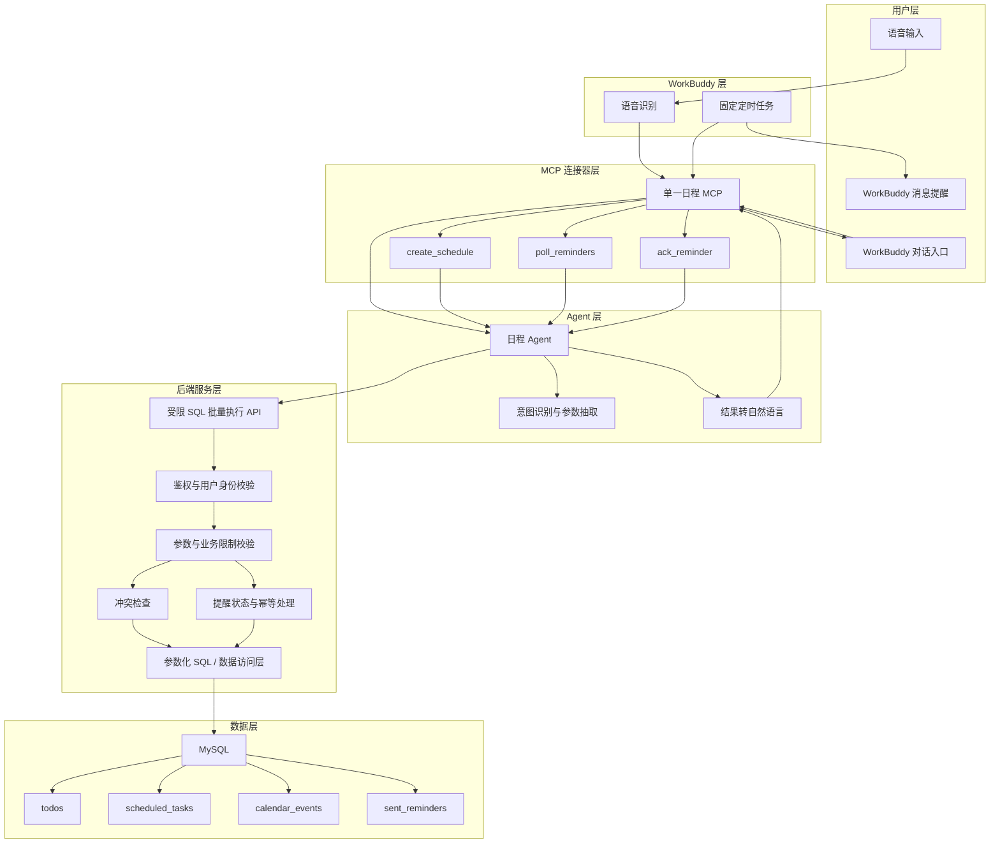
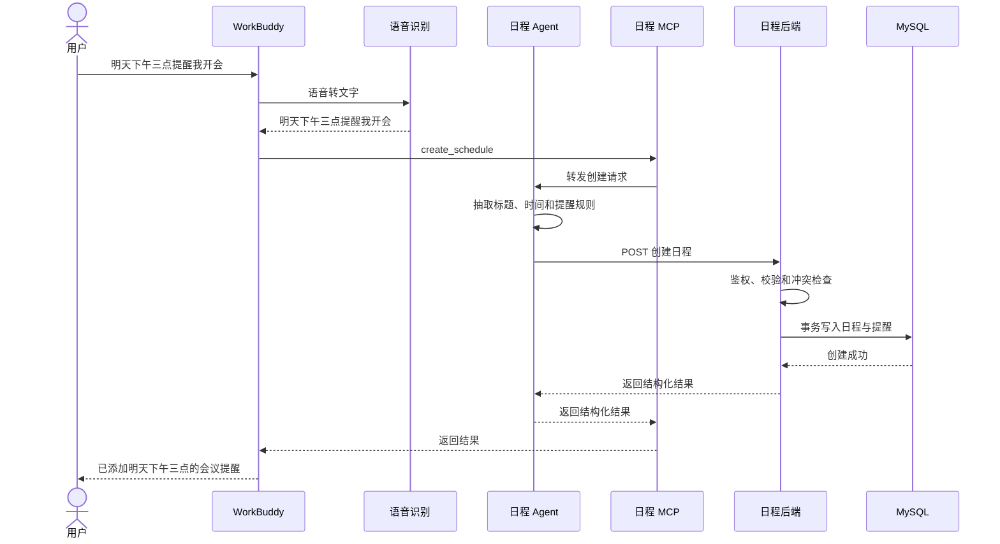
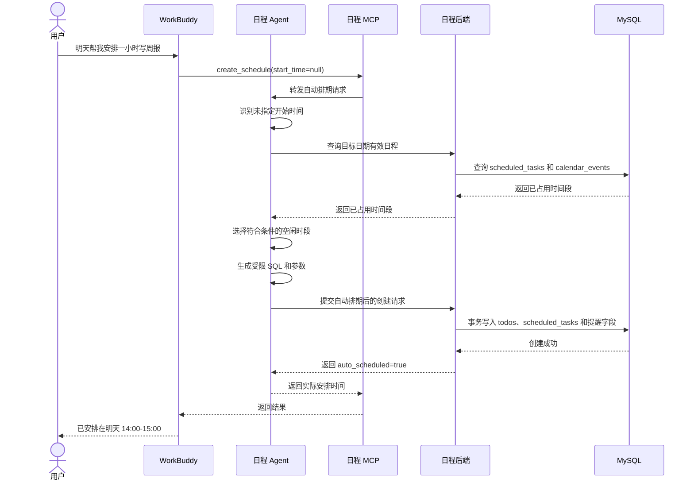
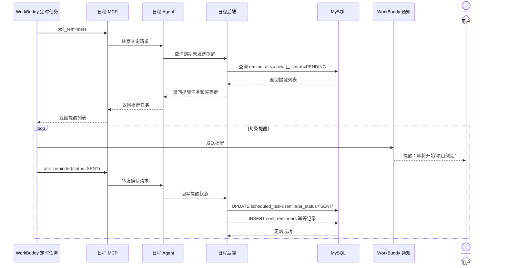

# WorkBuddy 日程工具技术方案

## 1. 方案概要

采用“WorkBuddy + 单一 MCP + 日程 Agent + 日程后端 + MySQL”的固定调用链：

```text
语音输入
  -> WorkBuddy 语音识别
  -> 日程 MCP
  -> 日程 Agent
  -> 日程后端
  -> MySQL

WorkBuddy 定时任务
  -> 日程 MCP
  -> 日程 Agent
  -> 日程后端
  -> MySQL
  -> WorkBuddy 通知
```

WorkBuddy 不直接调用后端，MCP 只负责连接 WorkBuddy 和 Agent；Agent 负责理解用户意图、生成受限 SQL 和绑定参数、计算自动排期并调用后端；后端负责最终可信的鉴权、校验、冲突检查、事务和数据操作。

## 2. 分层架构



## 3. 模块职责

### 3.1 WorkBuddy

- 提供语音输入、语音识别和用户会话入口。
- 运行固定周期的定时任务。
- 通过 MCP 接收 Agent 返回的自然语言结果并展示。
- 发送提醒消息。
- 不直接调用后端，不直接访问 MySQL。

### 3.2 日程 MCP

- 仅提供一个 MCP 服务。
- 暴露 `create_schedule`、`poll_reminders`、`ack_reminder` 三个工具。
- 负责 WorkBuddy 与 Agent 之间的协议适配、请求转发和结果透传。
- 不直接调用后端，不直接访问 MySQL，不承载业务规则。

### 3.3 日程 Agent

- 识别创建日程意图。
- 抽取标题、日期、开始时间、结束时间或时长、提醒规则和时区。
- 将文字转换为受限 SQL 和参数数组。
- 判断请求是否缺少开始时间；未指定时查询占用时段并计算空闲时间。
- 根据后端返回结果生成确认、失败或补充信息，并经 MCP 返回 WorkBuddy。
- 只对顶层 `retryable=true` 的错误修正 SQL/参数；单次逻辑请求最多 3 轮完整尝试，每轮可包含查询和创建。
- 不直接访问 MySQL。

### 3.4 日程后端

- 负责 Agent 内部接口的服务认证和权限校验；本工具为单用户模型，不实现租户隔离字段。电脑和手机前端及其普通 API 无需认证，打开即可使用；普通 API 仍负责参数、业务限制和冲突校验。
- 负责参数格式、时间范围、日程时长和提醒规则校验。
- 负责指定时间的冲突检查。
- 负责最终时间冲突检查；自动排期决策由 Agent 完成。
- 负责校验 Agent 传入的 SQL，仅允许声明的表、字段和参数化 SELECT/INSERT/UPDATE。
- 负责事务、幂等、提醒状态和错误码。
- 通过参数化数据访问层访问 MySQL。

## 4. MCP 工具与后端 SQL 接口

### 4.1 WorkBuddy -> MCP -> Agent 工具

单一 MCP 暴露三个工具：

| 工具 | 输入 | Agent 行为 |
|---|---|---|
| `create_schedule` | 用户原始文本、`request_id` | 解析指定时间或自动排期意图，生成 SQL 和参数 |
| `poll_reminders` | 当前时间、结果数量上限 | 生成查询到期提醒的 SELECT SQL |
| `ack_reminder` | 排期 ID、幂等键、发送结果 | 生成状态更新及成功记录 SQL |

MCP 只负责调用 Agent 并透传结果，不直接访问后端或 MySQL。

### 4.2 Agent -> 后端受限 SQL 批量执行接口

```text
POST /api/internal/sql/execute
```

请求：

```json
{
  "request_id": "uuid",
  "attempt": 1,
  "max_attempts": 3,
  "operation": "CREATE_SCHEDULE",
  "statements": [
    {
      "sql": "INSERT INTO todos (title, priority, estimate_min, request_id) VALUES (%s, %s, %s, %s)",
      "params": ["准备资料", 2, 60, "uuid"]
    },
    {
      "sql": "INSERT INTO scheduled_tasks (todo_id, start_at, end_at, schedule_source) VALUES (%s, %s, %s, %s)",
      "params": [123, "2026-10-08 15:00:00", "2026-10-08 16:00:00", "MANUAL"]
    }
  ]
}
```

约束与行为：

- `attempt` 是完整尝试轮次，范围为 1..3，首次请求记为 1；一轮中的查询和创建共享同一个序号；`max_attempts` 由后端配置且上限为 3。
- SQL 必须使用绑定参数；禁止拼接用户文本和多语句 SQL 字符串。
- 后端使用 MySQL 方言 SQL AST 校验，只允许访问 `todos`、`scheduled_tasks`、`sent_reminders`、`calendar_events` 的允许字段和 `SELECT`、`INSERT`、`UPDATE` 操作。
- 禁止 DDL、DELETE、系统表访问、未授权字段、任意函数和 AST 无法解析的语句。
- `statements` 按顺序在同一事务执行；任一语句失败则整体回滚。
- `request_id` 唯一标识一次逻辑请求；重复成功请求返回首次结果，不重复写入。
- SELECT 返回行集；写入返回受限的行数和插入 ID，不返回数据库连接或内部异常细节。

成功响应：

```json
{
  "request_id": "uuid",
  "success": true,
  "attempt": 1,
  "transaction": "COMMITTED",
  "results": [
    {"statement_index": 0, "row_count": 1, "last_insert_id": 123},
    {"statement_index": 1, "row_count": 1, "last_insert_id": 456}
  ]
}
```

失败响应：

```json
{
  "request_id": "uuid",
  "success": false,
  "attempt": 2,
  "retryable": true,
  "error": {"code": "TIME_CONFLICT", "message": "时间段与已有日程冲突"}
}
```

Agent 仅在顶层 `retryable=true` 且 `attempt < max_attempts` 时修正 SQL/参数并重试；三轮完整尝试都失败后返回最终错误。

### 4.3 SQL 操作模板约束

- 创建日程：一个事务内 INSERT `todos`、INSERT `scheduled_tasks`。
- 指定时间冲突检查：先 SELECT `scheduled_tasks` 和 `calendar_events`；最终 INSERT 前后端在事务内再次检查。
- 自动排期：Agent 读取两类占用时段、按工作时段选择档期，再提交创建事务。
- 查询待提醒：SELECT `scheduled_tasks` JOIN `todos`，过滤有效、未完成、已到期记录。
- 提醒成功确认：一个事务内 UPDATE `scheduled_tasks` 并 INSERT `sent_reminders`。
- 提醒失败确认：只 UPDATE `scheduled_tasks` 的失败状态和错误字段，不插入 `sent_reminders`。

## 5. 关键时序

### 5.1 指定时间创建



### 5.2 未指定时间自动排期



### 5.3 定时提醒



## 6. 数据模型

### 6.1 `todos`

| 字段 | 类型 | 说明 |
|------|------|------|
| id | INT | 待办主键 |
| title | VARCHAR(500) | 待办或日程标题 |
| priority | INT | 优先级 |
| deadline | DATETIME | 截止时间 |
| estimate_min | INT | 预计时长，分钟 |
| timezone | VARCHAR(64) | 用户时区 |
| request_id | VARCHAR(64) | 请求幂等标识 |
| auto_scheduled | TINYINT | 是否自动排期 |

### 6.2 `scheduled_tasks`

| 字段 | 类型 | 说明 |
|------|------|------|
| id | INT | 排期主键 |
| todo_id | INT | 关联 todos.id |
| start_at | DATETIME | 开始时间，UTC |
| end_at | DATETIME | 结束时间，UTC |
| timezone | VARCHAR(64) | 用户时区 |
| schedule_source | VARCHAR(20) | MANUAL/AUTO |
| status | VARCHAR(20) | ACTIVE/CANCELLED/COMPLETED |
| reminder_at | DATETIME | 提醒时间，UTC |
| reminder_status | VARCHAR(20) | PENDING/PROCESSING/SENT/FAILED/CANCELLED |
| reminder_idempotency_key | VARCHAR(128) | 提醒幂等键 |

### 6.3 其他占用和幂等表

- `calendar_events`：手动日历事件，自动排期的占用来源。
- `sent_reminders`：成功发送提醒的去重记录。

## 7. 技术约束

1. Agent、MCP 和 WorkBuddy 均不得直接连接 MySQL。
2. MCP 只作为 WorkBuddy 与 Agent 的连接器，不调用后端、不执行 SQL、不承载业务规则。
3. Agent 通过 `POST /api/internal/sql/execute` 提交受限 SQL 和绑定参数，后端必须重新解析校验。
4. 只允许参数化 SELECT/INSERT/UPDATE，并限制在现有日程表和白名单字段内。
5. 多条 SQL 必须在同一事务中执行，任一失败整体回滚。
6. 自动排期在写入前必须再次检查冲突，避免并发请求产生重叠日程。
7. 提醒轮询和确认必须使用幂等键，支持重复调用和失败重试。
11. LLM 供应商由部署配置注入；文档不绑定具体供应商。
8. Agent 单次逻辑请求最多 3 轮完整尝试；每轮可包含查询和创建，冲突后重新查询。
9. 时间统一按 UTC 存储，接口输入输出携带用户时区或明确的时区偏移。
10. 本工具为单用户模型，不新增 user_id、tenant_id 或 organization_id。

## 8. 统一错误、时间与认证约束

错误响应统一为 `{"retryable": true|false, "error": {"code": "...", "message": "..."}}`；不得把 `retryable` 放入 `error`。后端对每轮执行最终鉴权、业务限制和冲突检查，不能以通用 SQL 批次绕过校验。兼容保留的 `SQL_BATCH` 仅允许白名单表上的只读 `SELECT`；所有写操作必须使用专用 operation 和业务模板。时间按 UTC 存储并携带 IANA 时区；默认时长 30 分钟，查询范围由 `SCHEDULE_HORIZON_DAYS` 控制。WorkBuddy 负责提醒轮询、发送和确认。

## 9. 非功能要求

- **安全性**：仅 Agent 到后端的 `POST /api/internal/sql/execute` 使用服务认证，凭据由服务部署配置提供。电脑和手机前端及其普通 `/api/*` 接口无需登录、密码或访问令牌；前端不持有内部服务令牌。单用户数据不做租户分区；敏感日志不得记录完整用户隐私内容。
- **可靠性**：提醒处理失败可重试；创建事务失败不得产生半成品日程。
- **可观测性**：记录 request_id、MCP tool、后端错误码和处理耗时。
- **扩展性**：后续可增加修改、取消和查询日程能力，但仍通过同一个 MCP 暴露。


### T05 占用查询边界

`FIND_AVAILABLE_SLOTS` 携带 `date`、可选 `end_date`（均含当天，缺省只查目标日期）、`timezone`、`duration_min`（缺省 30）及可选 `deadline`。查询日期限定在用户时区的今天起 `SCHEDULE_HORIZON_DAYS` 个日历日内。Agent 用本地午夜边界转换后的 UTC 参数查询有效且未完成的 `scheduled_tasks`，同时按本地日期查询 `calendar_events`；后端验证两条 SELECT 的模板和绑定范围，仅返回可 JSON 序列化的占用行（ISO 日期/时间），不缓存占用查询。Agent 合并占用后按 `WORK_HOURS`、截止时间和 5 分钟粒度计算候选；查询不写库。日历事件日期/时间按请求的日历时区解释。


### 远程 MCP 接入（T11 联调准备）

WorkBuddy 云端使用 Streamable HTTP，通过 HTTPS URL 访问独立 MCP 服务的 `/mcp` 端点；本地 stdio 继续可用。HTTP 传输采用无会话模式：POST 接收单条 JSON-RPC，请求返回 `application/json`，通知和客户端响应返回 HTTP 202；不提供服务器主动推送流，GET/DELETE 返回 405，不分配 `Mcp-Session-Id`。初始化后客户端携带 `MCP-Protocol-Version`，支持 2025-03-26、2025-06-18、2025-11-25；缺省按 2025-03-26 处理。

HTTP MCP 仅做协议适配，仍经本地 Agent 调用后端。远程入口要求独立 Bearer 令牌 `SCHEDULE_MCP_HTTP_TOKEN`，不复用后端内部服务令牌；配置 `SCHEDULE_MCP_ALLOWED_ORIGINS` 校验带 Origin 的请求，无 Origin 的服务器客户端可以连接。服务默认绑定 127.0.0.1:7801，由部署提供 HTTPS 反向代理或隧道。该入口认证不改变普通前端 API 免认证的约定。真实验收仍要求 WorkBuddy 调用记录和数据库快照，本地 HTTP 测试不替代真实验收。
