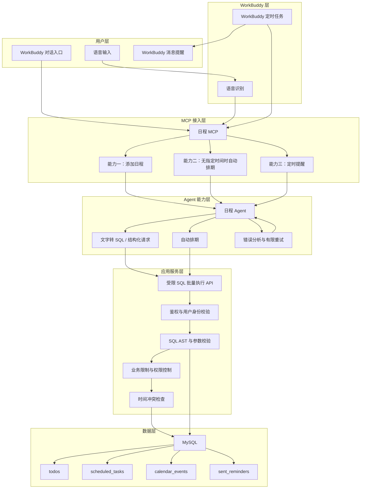
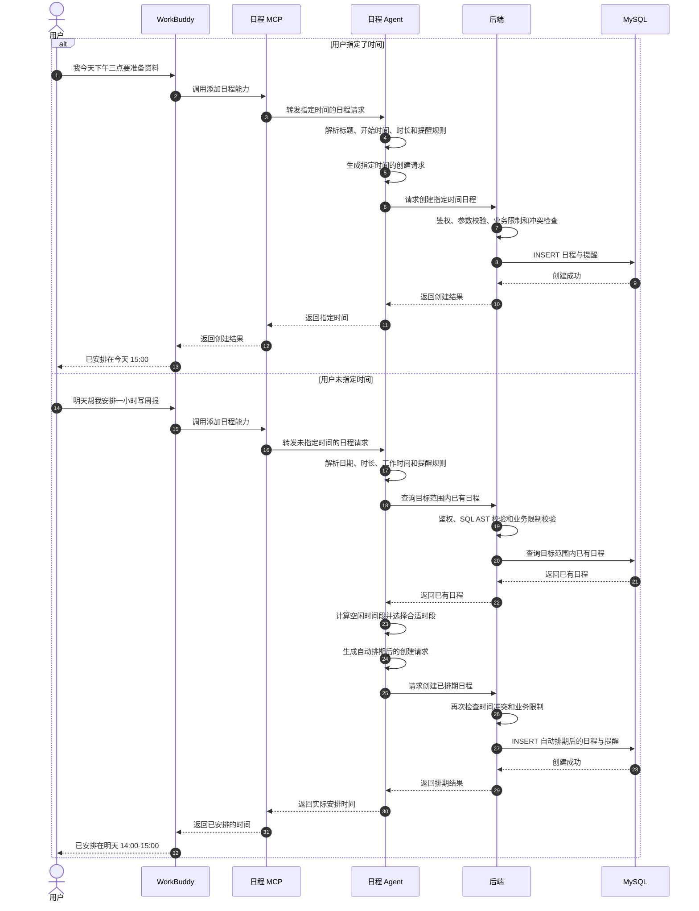
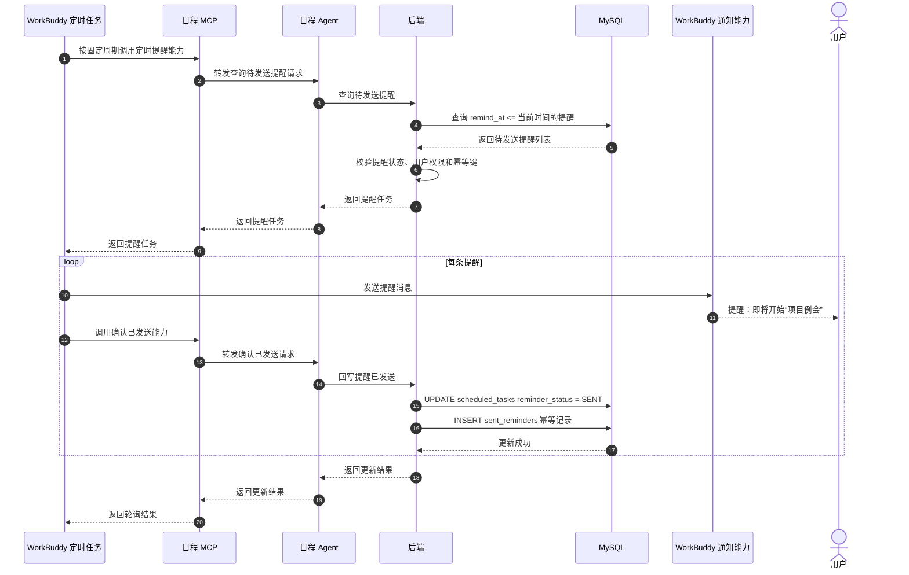

# WorkBuddy 日程工具架构

## 1. 目标

在现有 `schedule-tool` 的基础上，引入 WorkBuddy MCP 和后端服务，实现：

- 通过语音添加待办或日程
- 添加日程时未指定时间，自动寻找空闲时间段并插入
- 由 WorkBuddy 定时任务轮询后端并发送提醒
- 使用 MySQL 持久化日程、待办和提醒数据

核心链路如下：

```text
语音输入 -> WorkBuddy 语音识别 -> 日程 MCP -> 日程 Agent
       -> 后端鉴权、校验、限制、冲突检查 -> MySQL

WorkBuddy 定时任务 -> 日程 MCP -> 日程 Agent -> 后端查询到期提醒 -> WorkBuddy 通知用户
```

## 2. 分层架构



## 3. 添加日程事件时序

```mermaid
sequenceDiagram
    autonumber
    actor U as 用户
    participant WB as WorkBuddy
    participant ASR as 语音识别
    participant M as 日程 MCP
    participant A as 日程 Agent
    participant B as 后端
    participant V as 校验与限制
    participant DB as MySQL

    U->>WB: 明天下午三点提醒我开会
    WB->>ASR: 语音转文字
    ASR-->>WB: 明天下午三点提醒我开会
    WB->>M: 调用添加日程能力
    M->>A: 转发用户文本和请求参数
    A->>A: 解析意图、标题、时间和提醒规则
    A->>A: 将文字转换为 SQL / 结构化后端请求
    A->>B: 请求创建日程
    B->>V: 鉴权、参数校验、SQL 安全校验
    V->>V: 检查时间格式、权限和业务限制
    V->>V: 检查时间冲突和提醒规则

    alt 校验通过
        V->>DB: INSERT 日程与提醒记录
        DB-->>V: 创建成功
        V-->>B: 返回日程 ID
        B-->>A: 返回日程信息
        A-->>M: 返回创建结果
        M-->>WB: 返回日程信息
        WB-->>U: 已添加明天下午三点的会议提醒
    else 校验失败
        V-->>B: 返回错误原因
        B-->>A: 返回校验或限制错误
        loop 后续尝试，attempt=2..3（总尝试次数最多3次，含首次）
            A->>A: 分析错误并修正请求/SQL
            A->>B: 使用修正后的请求重试
            B->>V: 重新鉴权、校验和检查限制
            alt 重试通过
                V->>DB: INSERT 日程与提醒记录
                DB-->>V: 创建成功
                V-->>B: 返回日程 ID
                B-->>A: 返回创建结果
                A-->>M: 返回创建结果
                M-->>WB: 返回日程信息
                break 创建成功
            else 重试仍失败
                V-->>B: 返回错误原因
                B-->>A: 返回错误供下一次重试
            end
        end
        opt 达到重试上限且仍失败
            A-->>M: 返回最终错误
            M-->>WB: 返回创建失败信息
            WB-->>U: 日程创建失败，请检查时间或补充信息
        end
    end
```

## 4. 日程创建与自动排期时序



## 5. 定时提醒事件时序



## 6. 关键职责和边界

### 日程 MCP

- 只有一个日程 MCP
- 日程 MCP 暴露 `create_schedule`、`poll_reminders`、`ack_reminder` 三个工具
- 日程 MCP 只负责接收 WorkBuddy 请求、转发给 Agent 并透传结果
- 日程 MCP 不直接调用后端，不执行 SQL，不负责文字理解和自动排期

### 日程 Agent

- 负责解析用户文本，提取标题、时间、时长和提醒规则
- 负责将文字转换为受限 SQL 和绑定参数
- 负责未指定时间时查询已有日程、计算空闲时间并生成排期结果
- 负责分析后端校验或限制错误并修正请求
- 单次逻辑请求最多 3 轮完整尝试，包含首次；每轮可包含查询和创建，后端可降低配置上限，不得提高到 3 轮以上
- 达到重试上限后返回最终错误，不再继续调用后端

### 后端

- 负责 Agent 内部接口的服务身份和权限校验；电脑和手机前端及其普通 API 无需认证，打开即可使用
- 负责请求参数、时间范围和提醒规则校验
- 负责业务限制，例如最大提前时间、最长日程时长和查询范围
- 负责最终时间冲突检查，不负责自动排期决策
- 负责 SQL AST、表/字段白名单、参数校验、事务和幂等处理
- 负责向 Agent 返回稳定的错误码和错误信息

### MySQL

沿用并扩展以下既有表，不创建独立的日程/提醒主表：

```text
todos
- id
- title
- priority
- deadline
- estimate_min
- timezone
- request_id
- auto_scheduled

scheduled_tasks
- id
- todo_id
- start_at
- end_at
- schedule_source
- status
- reminder_at
- reminder_status
- reminder_idempotency_key
- reminder_attempt_count
- reminder_error

calendar_events
- id
- event_date
- start_time
- end_time

sent_reminders
- id
- scheduled_task_id
- sent_at
- idempotency_key
```

## 7. 安全与可靠性要求

1. WorkBuddy、MCP 和 Agent 都不能直接连接 MySQL，后端是最终可信边界。
2. Agent 通过 `POST /api/internal/sql/execute` 提交 SQL statements 和绑定参数；后端校验后执行。
3. 只允许参数化 `SELECT`、`INSERT`、`UPDATE`，并只允许 `todos`、`scheduled_tasks`、`calendar_events`、`sent_reminders` 的白名单字段。
4. 禁止 DDL、DELETE、系统表访问、任意函数、未授权字段和多语句 SQL 字符串。
5. 同一请求的多条 SQL 在一个事务中执行；任一失败整体回滚。
6. 创建日程和提醒状态写入必须幂等；提醒成功记录只写入 `sent_reminders`。
7. 提醒失败保留在 `scheduled_tasks`，由后续轮询重试；当前只有一个 WorkBuddy 定时任务，不实现租约抢占。
8. 所有 WorkBuddy 新接口时间字段按 UTC 存储，接口同时携带用户时区。
9. Agent 单次逻辑请求最多 3 轮完整尝试，包含首次；每轮可包含查询和创建，达到上限后返回最终错误。
10. 本工具为单用户自用工具，不增加用户或租户字段。电脑和手机前端及其普通 `/api/*` 接口无需登录、密码或访问令牌；仅 Agent 调用 `POST /api/internal/sql/execute` 时使用服务认证，凭据由服务部署配置提供，不交给前端。前端免认证不免除参数、业务限制和冲突校验。上述 WorkBuddy 链路适用于 WorkBuddy 集成，普通前端继续直接调用后端。
11. 错误响应顶层包含 retryable，error 仅包含 code 和 message；提醒由 WorkBuddy 轮询、发送并确认。
12. LLM 供应商由部署配置决定，不在架构中写死。


### T05 占用查询边界

`FIND_AVAILABLE_SLOTS` 携带 `date`、可选 `end_date`（均含当天，缺省只查目标日期）、`timezone`、`duration_min`（缺省 30）及可选 `deadline`。查询日期限定在用户时区的今天起 `SCHEDULE_HORIZON_DAYS` 个日历日内。Agent 用本地午夜边界转换后的 UTC 参数查询有效且未完成的 `scheduled_tasks`，同时按本地日期查询 `calendar_events`；后端验证两条 SELECT 的模板和绑定范围，仅返回可 JSON 序列化的占用行（ISO 日期/时间），不缓存占用查询。Agent 合并占用后按 `WORK_HOURS`、截止时间和 5 分钟粒度计算候选；查询不写库。日历事件日期/时间按请求的日历时区解释。


### 远程 MCP 接入（T11 联调准备）

WorkBuddy 云端使用 Streamable HTTP，通过 HTTPS URL 访问独立 MCP 服务的 `/mcp` 端点；本地 stdio 继续可用。HTTP 传输采用无会话模式：POST 接收单条 JSON-RPC，请求返回 `application/json`，通知和客户端响应返回 HTTP 202；不提供服务器主动推送流，GET/DELETE 返回 405，不分配 `Mcp-Session-Id`。初始化后客户端携带 `MCP-Protocol-Version`，支持 2025-03-26、2025-06-18、2025-11-25；缺省按 2025-03-26 处理。

HTTP MCP 仅做协议适配，仍经本地 Agent 调用后端。远程入口要求独立 Bearer 令牌 `SCHEDULE_MCP_HTTP_TOKEN`，不复用后端内部服务令牌；配置 `SCHEDULE_MCP_ALLOWED_ORIGINS` 校验带 Origin 的请求，无 Origin 的服务器客户端可以连接。服务默认绑定 127.0.0.1:7801，由部署提供 HTTPS 反向代理或隧道。该入口认证不改变普通前端 API 免认证的约定。真实验收仍要求 WorkBuddy 调用记录和数据库快照，本地 HTTP 测试不替代真实验收。
